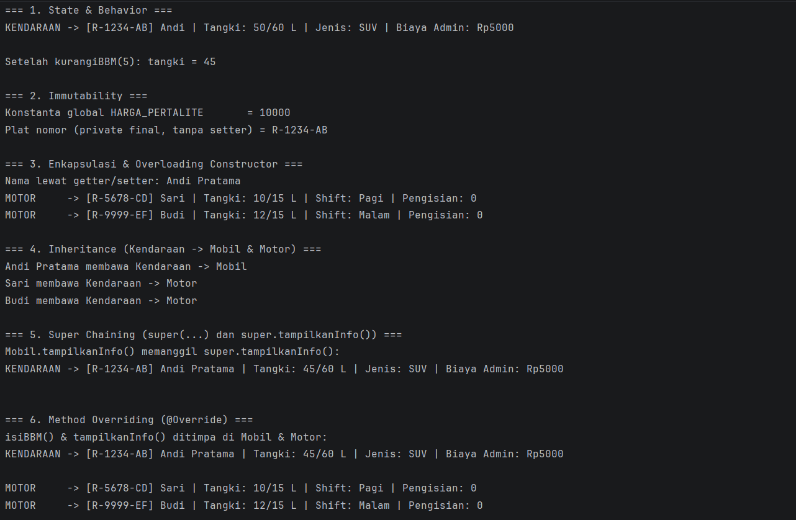
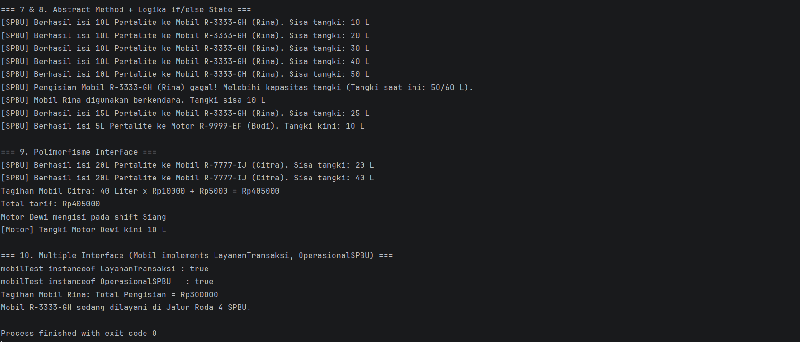

# Responsi Akhir Praktikum PBO - Sistem SPBU

Project ini dibuat untuk memenuhi Tugas Responsi Akhir Praktikum Pemrograman Berorientasi Objek (PBO) Jurusan Informatika, Universitas Jenderal Soedirman.

## Identitas Mahasiswa
- **Nama**: [Michael Jefferson]
- **NIM**: [H1D025132]
- **Digit Terakhir NIM**: 2
- **Tema Sistem**: SPBU

---
## Deskripsi Singkat

Sistem mensimulasikan operasional pengisian Bahan Bakar Minyak (BBM) di SPBU pada kendaraan (Mobil dan Motor). Setiap kendaraan memiliki kapasitas tangki dan sisa BBM; keputusan menerima atau menolak pengisian BBM bergantung pada kondisi (*state*) kapasitas tangki tersebut.

| File | Peran |
| :--- | :--- |
| `LayananTransaksi.java` | Interface: tarif dan cetak struk |
| `OperasionalSPBU.java` | Interface: status jalur SPBU |
| `Kendaraan.java` | Abstract superclass |
| `Mobil.java` | Subclass, implements `LayananTransaksi` dan `OperasionalSPBU` |
| `Motor.java` | Subclass, implements `LayananTransaksi` |
| `Main.java` | Pengujian 10 persyaratan |

---

## Pemetaan Persyaratan Teknis

| No | Konsep | Lokasi dalam kode |
| :---: | :--- | :--- |
| **1** | State & Behavior | `Kendaraan` : atribut `isiTangki`, `kapasitasTangki` ; void `kurangiBBM()` ; fungsi `getIsiTangki()` |
| **2** | Immutability | `HARGA_PERTALITE` (`public static final`) ; `platNomor` (`private final`) |
| **3** | Enkapsulasi & Overloading | Semua atribut `private` + getter/setter, `this`, dua constructor di setiap class |
| **4** | Inheritance | `Mobil` dan `Motor` `extends Kendaraan` ; `Main` terpisah |
| **5** | Super Chaining | `super(...)` di constructor subclass; `super.tampilkanInfo()` |
| **6** | Overriding | `@Override` pada `isiBBM()` dan `tampilkanInfo()` |
| **7** | Abstract Class | `Kendaraan` `abstract` dengan `abstract void isiBBM(double liter)` |
| **8** | Logika State | `if/else` di `isiBBM()` membaca kapasitas dan isi tangki, lalu mengubahnya |
| **9** | Polimorfisme Interface | `LayananTransaksi mobilCitra = new Mobil(...)`, `OperasionalSPBU mobilTest = new Mobil(...)` |
| **10**| Multiple Interface | `Mobil` `implements LayananTransaksi, OperasionalSPBU` |
---

## Petunjuk Compile dan Run (Terminal)

Prasyarat: JDK 11 atau yang lebih baru.

```bash
# 1. Clone repositori dari GitHub
git clone <URL-REPOSITORI-ANDA>
cd SPBUPBO

# 2. Compile seluruh source code Java (Hasil kompilasi disimpan ke folder out)
javac -d out src/*.java

# 3. Jalankan program Main
java -cp out Main
```
## Screenshot Luaran Program

> Jalankan program, ambil screenshot terminal, simpan di folder `screenshots/`, lalu ganti baris di bawah.

Persyaratan 1-6:



Persyaratan 7-10:



